# Laboratorio 8 — Maquetación responsiva con Flexbox, Grid y Media Queries

## 1. Ejecución del proyecto
**Rutas de prueba con Laravel en ejecución:**

- `http://127.0.0.1:8000/frontend/calendario.html`
- `http://127.0.0.1:8000/frontend/horario.html`
- `http://127.0.0.1:8000/frontend/tareas.html`

Para iniciar el servidor desde la raíz del proyecto Laravel, ejecutar `php artisan serve`.

## 2. Cumplimiento de los requisitos técnicos

### 2.1. HTML semántico y jerarquía de encabezados — 20 puntos

Las tres páginas utilizan un documento HTML en español (`lang="es"`), un encabezado principal `h1` por pantalla y regiones estructurales como `header`, `nav`, `main`, `section`, `aside` y `footer` según corresponda. Se incorpora un enlace «Saltar al contenido» para facilitar la navegación mediante teclado.

**Archivos:** `calendario.html`, `horario.html` y `tareas.html`.

### 2.2. Maquetación con CSS Grid y Flexbox — 25 puntos

En `css/estilos.css` se utiliza **CSS Grid** para la organización general de regiones y cuadrículas, incluyendo el calendario y estructuras de formularios. Se utiliza **Flexbox** para distribuir elementos internos, como controles de navegación, barras de herramientas y grupos de botones.

**Justificación de Grid:** permite definir relaciones entre filas y columnas y reorganizar las regiones de la página de manera consistente al variar el espacio disponible.

**Justificación de Flexbox:** permite alinear, distribuir y adaptar elementos dentro de componentes de una sola dimensión sin recurrir a posiciones absolutas.

Las decisiones están documentadas mediante comentarios en la hoja de estilos, conforme lo indica el enunciado.

### 2.3. Diseño responsivo con enfoque móvil primero — 25 puntos

La hoja de estilos define estilos base para pantallas pequeñas y los amplía mediante consultas de medios. Se incluyen **tres puntos de quiebre:**

| Punto de quiebre | Equivalencia aproximada con fuente base de 16 px | Propósito |
|---|---:|---|
| `36rem` | 576 px | Ajustes para pantallas mayores que un móvil estrecho |
| `48rem` | 768 px | Adaptación a tamaños intermedios |
| `75rem` | 1200 px | Distribución para pantallas amplias |

Se realizaron las pruebas de las tres pantallas en los diferentes tamaños establecidos y todas funcionaron correctamente. Los elementos se adaptaron al espacio disponible, manteniendo una distribución ordenada y una buena legibilidad. No se observaron problemas de superposición, recortes de contenido ni desplazamientos horizontales innecesarios, por lo que el diseño responsivo presentó un funcionamiento satisfactorio.

### 2.4. Formularios accesibles — 15 puntos

Los formularios de las pantallas **Generar horario** y **Tareas** emplean controles HTML asociados a etiquetas, agrupación de campos relacionados, restricciones de validación nativa y mensajes de error. La navegación por teclado debe permitir alcanzar y activar sus controles sin utilizar el mouse.

Se realizaron las pruebas de los formularios y todo funcionó correctamente. Al dejar campos obligatorios vacíos o ingresar datos incorrectos, se mostraron los mensajes de validación correspondientes. También se comprobó que es posible navegar entre los campos utilizando Tab y Shift + Tab, así como activar los botones con el teclado. Además, el foco se mantiene visible y sigue un orden adecuado, facilitando el uso de los formularios.

### 2.5. Unidades relativas, escalabilidad y guía visual — 15 puntos

La hoja de estilos utiliza propiedades personalizadas de CSS para colores, espaciados y otros valores de diseño, así como unidades relativas, principalmente `rem`. Se mantiene una identidad visual común entre las tres pantallas.

El requisito de escalabilidad exige verificar que la interfaz **permanece utilizable al aumentar el tamaño de fuente del navegador al 200 %**. Para fortalecer la evidencia, se puede comprobar también el zoom real del navegador al 200 %, distinguiendo ambas pruebas.

Se revisaron las pantallas de Calendario, Generar horario y Tareas utilizando Google Chrome. Se aumentó el tamaño de fuente y el zoom del navegador al 200 %, comprobando que los textos se mantienen legibles, los controles siguen visibles y los elementos no presentan problemas de superposición. También se verificó que los colores y la tipografía utilizados corresponden con la guía de interfaz definida en el Laboratorio 7 con algunas de las recomendaciones incluidas.

## 3. Evidencias gráficas

### 3.1. Calendario

**375 px — móvil**

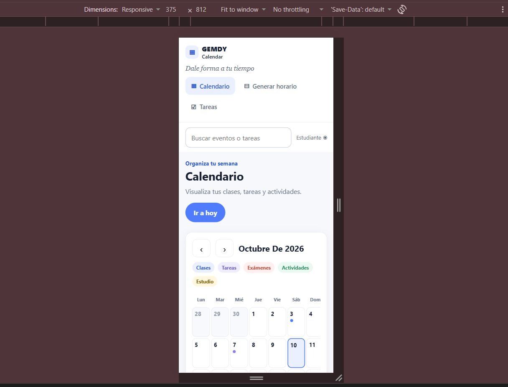

**768 px — tamaño intermedio**

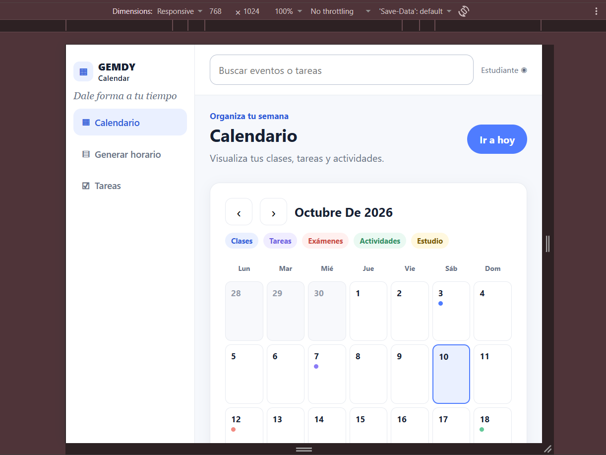

**1440 px — escritorio**

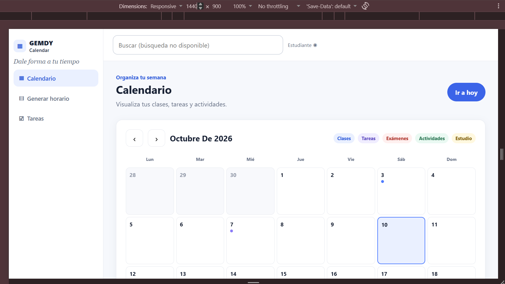

### 3.2. Generar horario

**375 px — móvil**

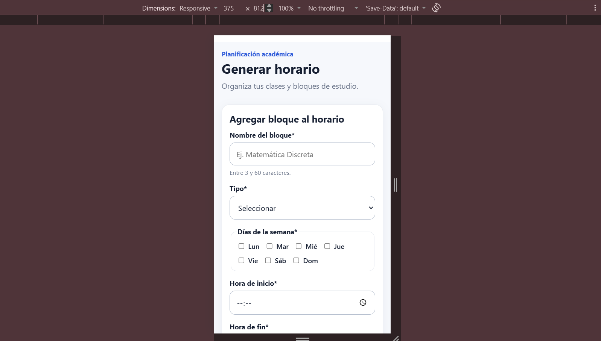
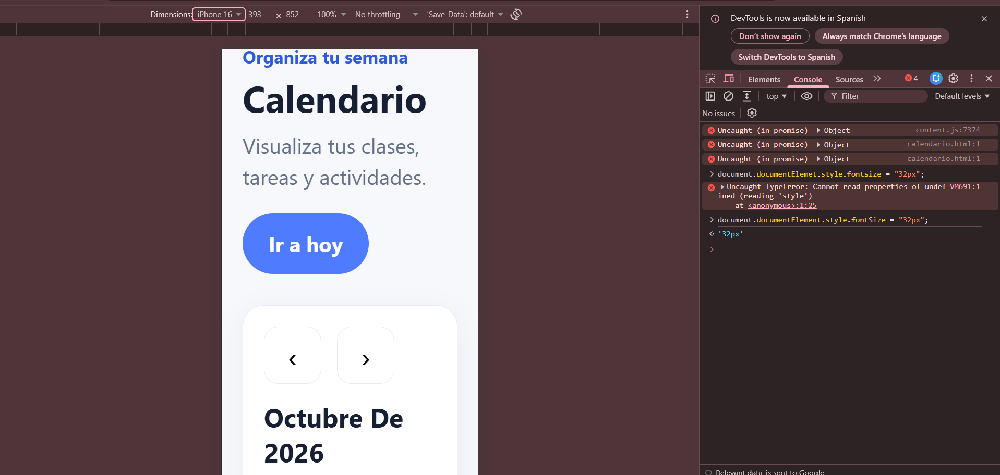

**768 px — tamaño intermedio**

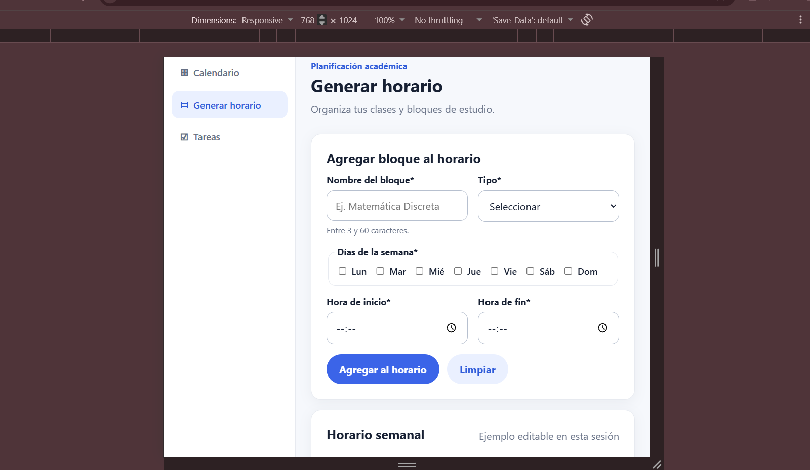

**1440 px — escritorio**

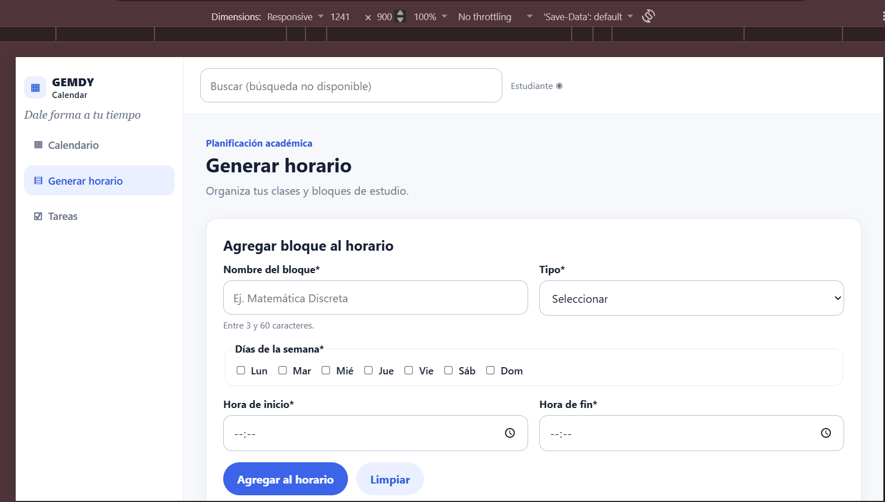

### 3.3. Tareas

**375 px — móvil**

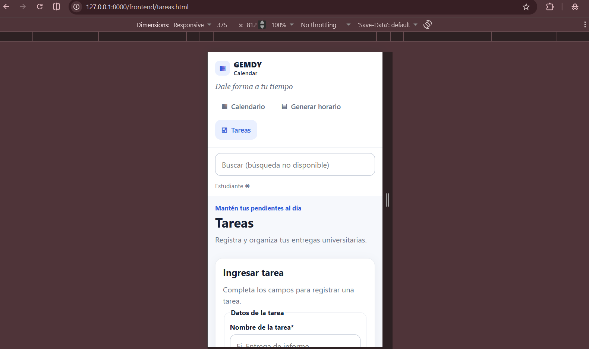

**768 px — tamaño intermedio**

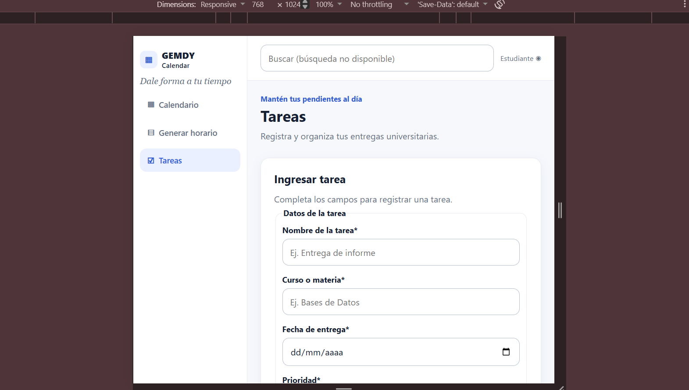

**1440 px — escritorio**

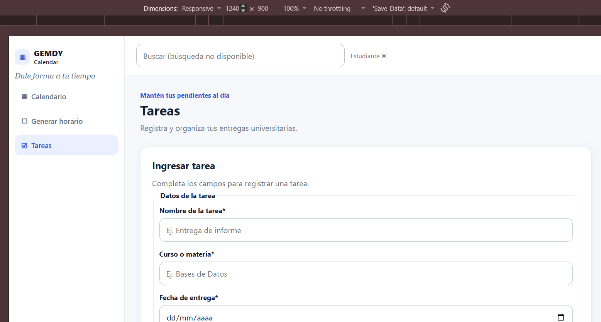

### 3.4. Tipografía aumentada al 200 %

**Calendario — 200 %**

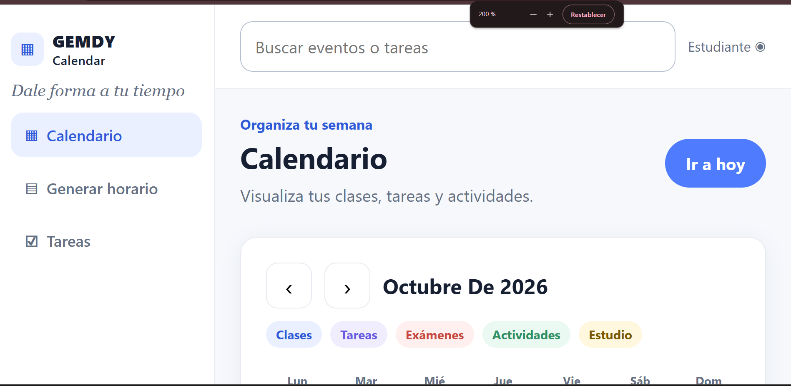

**Generar horario — 200 %**

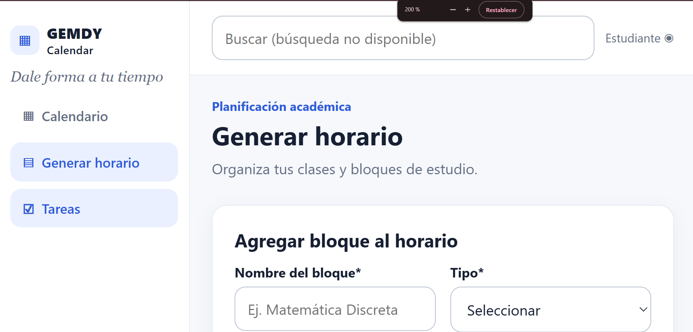

**Tareas — 200 %**

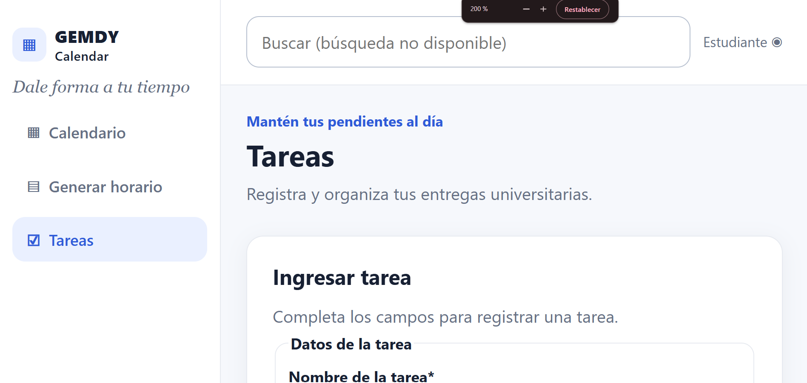

**Configuración exacta utilizada para el 200 %:** 
Se implementó tanto el tamaño de la fuente en 32px, como el zoom 200%.

### 3.5. Navegación exclusiva con teclado

**Enlace «Saltar al contenido» visible al recibir foco:**

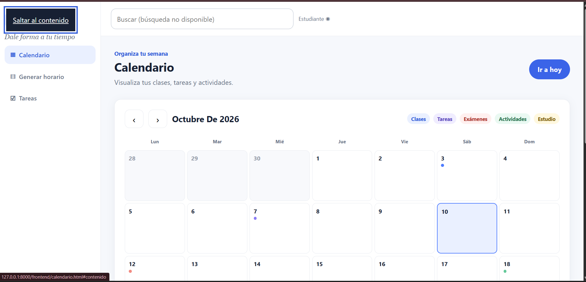
**Comportamiento comprobado al pulsar Enter en «Saltar al contenido»:** 
Procede de manera correcta mostrando la siguiente ventana.

**Foco visible en un formulario o control interactivo:**

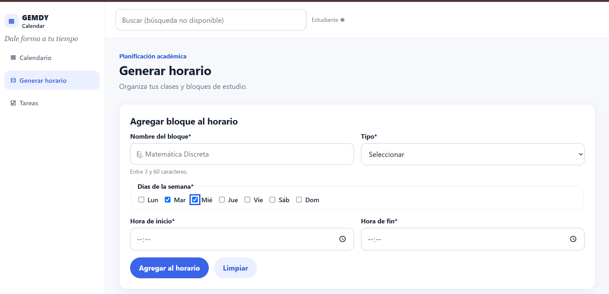

