# Laboratorio 9 — Evidencias de funcionamiento

## 1. Listado paginado y estados de interfaz

### 1.1 Estado con datos y paginación

Se observó el listado de tareas con registros, acciones de edición/eliminación y controles de paginación. Durante las pruebas se consultó una respuesta HTTP 200 y se trabajó con una lista de 15 tareas, distribuida en páginas de 10 registros.

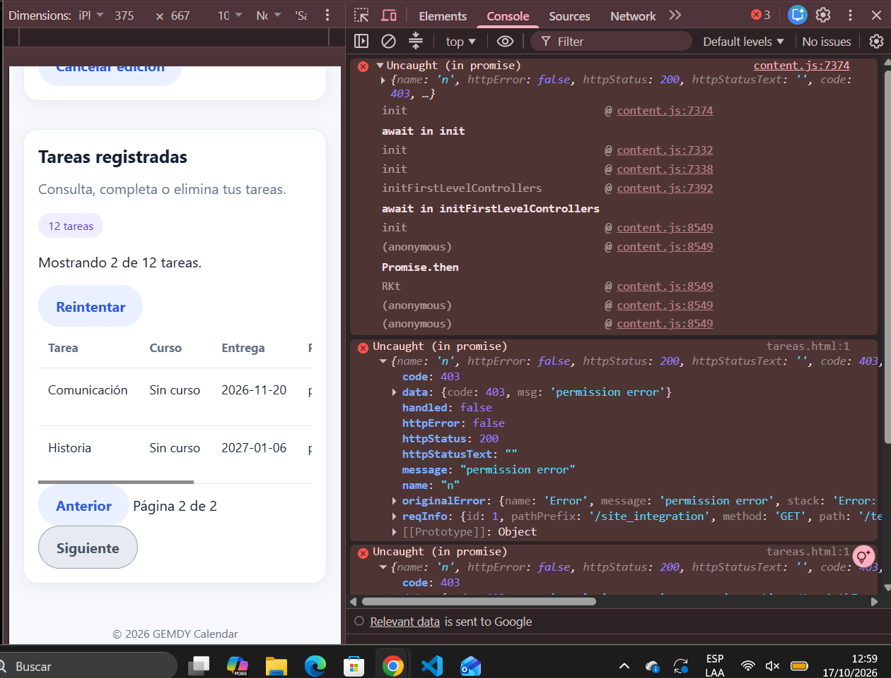

### 1.2 Estado vacío

Se probó una búsqueda sin coincidencias (`XYZPRUEBA99999`), cuya respuesta devolvió una colección vacía (`data: []`, `meta.total: 0`). La interfaz mostró el estado sin resultados.

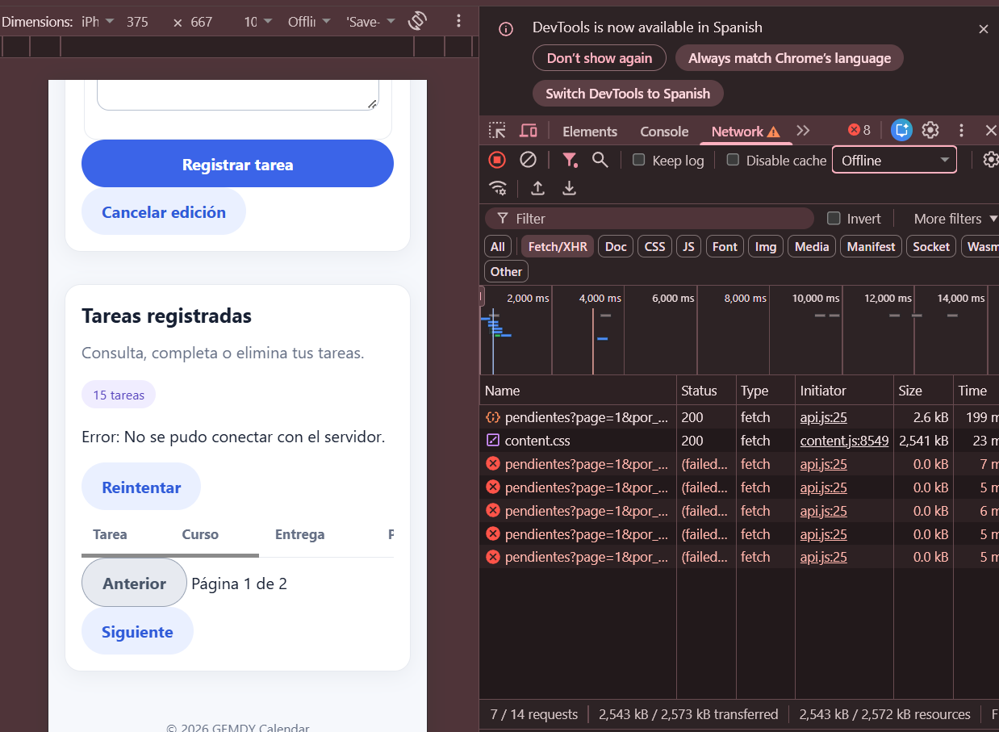

### 1.3 Estado de error y opción de reintento

Se simuló una falla de conexión; la interfaz presentó un mensaje de error y el botón **Reintentar**. Al recuperar la conexión y utilizar el reintento, el listado volvió a cargarse.

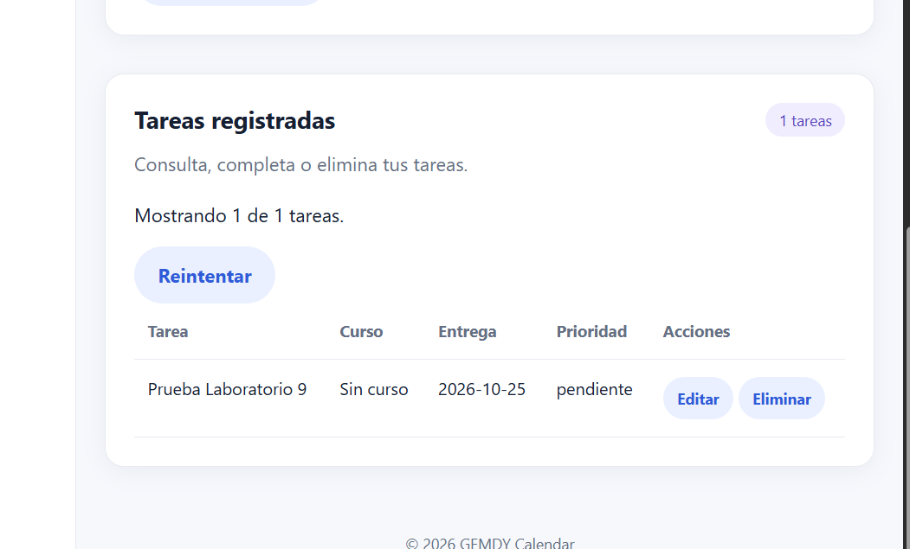

### 1.4 Estado de carga

Se configuró una conexión simulada **3G** en Chrome DevTools y se realizó una solicitud del listado. En la sección **Tareas registradas** se observó el texto **«Cargando tareas...»** mientras la solicitud `pendientes` estaba pendiente en Network. Esta captura demuestra el estado de carga del listado.

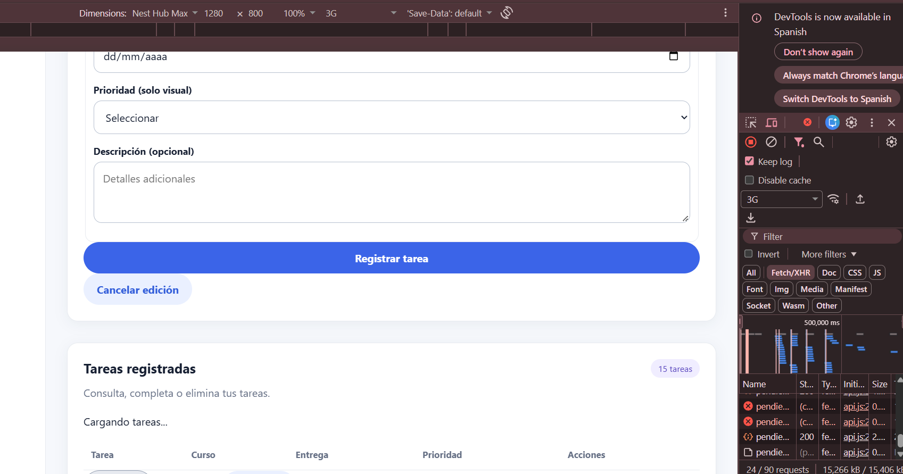

## 2. Creación, edición y validaciones

Se realizaron pruebas de creación y edición de tareas, con actualización del listado sin recargar manualmente la página. También se probó la cancelación de la edición.

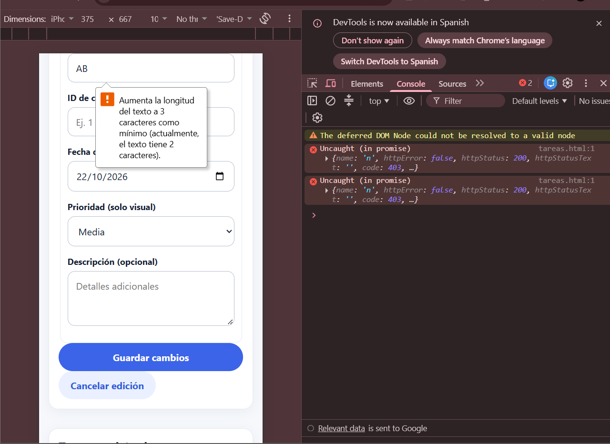

### 2.1 Validación nativa del navegador

Se verificó la restricción de longitud mínima del campo de nombre de tarea. Esta validación HTML complementa, pero no sustituye, las validaciones del backend.

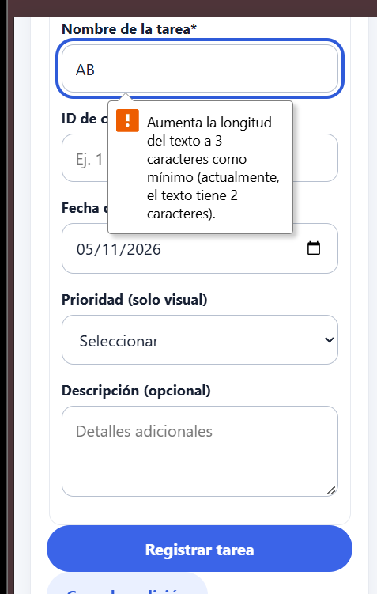

### 2.2 Errores de validación del backend

Se probaron errores de validación de Laravel (HTTP **422**) para datos inválidos, incluidos títulos demasiado cortos o identificadores de curso inexistentes. La interfaz mostró mensajes asociados al campo correspondiente.

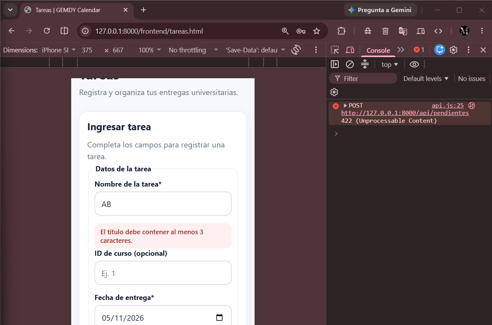

También se comprobó una regla de negocio relacionada con fechas no permitidas (HTTP **409**), mostrando un mensaje de error en el formulario.

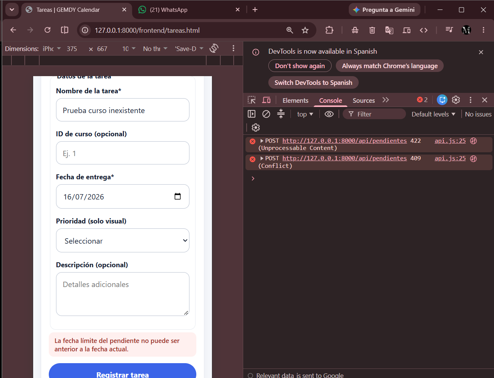

### 2.3 Conservación del estado de la tarea

Se corrigió y comprobó que, al editar una tarea que ya estaba completada, se conserva su estado original en lugar de cambiarla automáticamente a `pendiente`.

## 3. Sincronización del estado con la vista

El módulo `estado.js` y su mecanismo de suscripción permiten reflejar cambios del listado y del formulario sin una recarga manual de la página. Se comprobó el efecto al crear, editar, eliminar y filtrar registros. La eliminación utiliza confirmación antes de actualizar el listado.

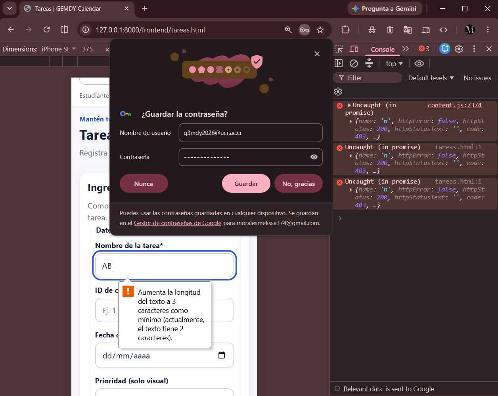

## 4. Búsqueda optimizada

Se revisó el uso de un **debounce de 350 ms** y de `AbortController` para cancelar solicitudes anteriores al cambiar el criterio de búsqueda. También se probó la consulta de una búsqueda sin coincidencias.

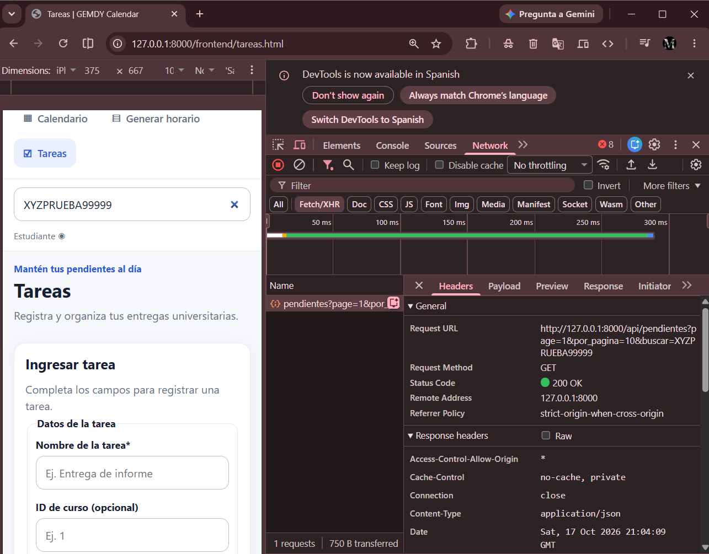

**Nota de alcance:** la imagen ilustra el uso de la búsqueda; la implementación de debounce y cancelación se sustenta principalmente en el código fuente, no en una captura estática.

## 5. Expiración de sesión: HTTP 401

Se invalidó el token de prueba y se ejecutó una solicitud autenticada `GET /auth/me`. En las herramientas de desarrollo de Chrome, pestaña **Network**, se observó una respuesta **401** para la solicitud `me`.

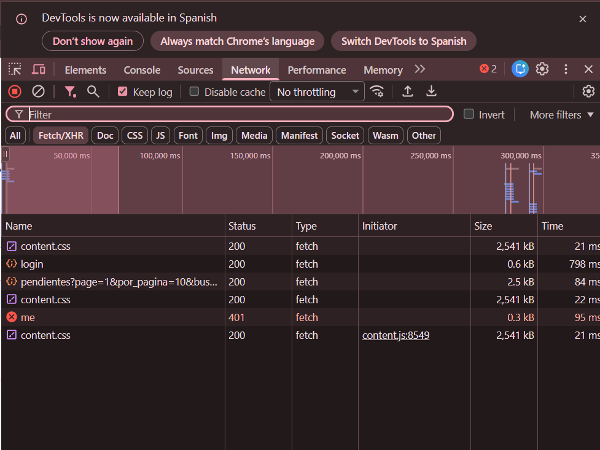

El cliente API detecta este código y ejecuta la invalidación del token y el evento `gemdy:unauthorized`. La aplicación redirigió a `login.html?sesion=expirada`.

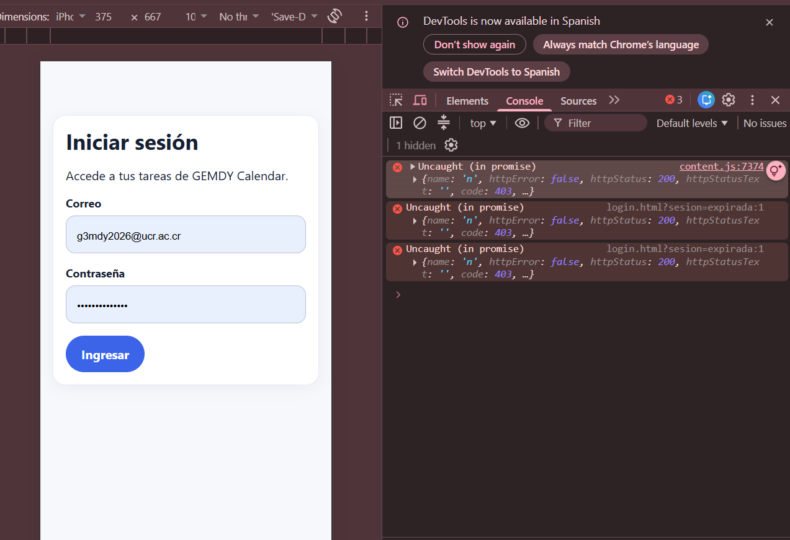

Después de iniciar sesión nuevamente, se comprobó que se recuperaban **los datos del formulario y el modo de edición**, evitando perder el trabajo que estaba en curso.

## 6. Promesas y sintaxis asíncrona

En la revisión de JavaScript se comprobó el uso de `async/await`, promesas y módulos para realizar las solicitudes. La evidencia principal es el código fuente de `api.js` y `tareas.js`.

