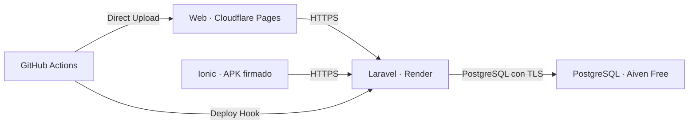

# Laboratorio 14 · Despliegue de Gemdy Calendar

## Arquitectura

La web de Cloudflare Pages y la app Ionic para Android consumen la API Laravel mediante HTTPS y tokens Bearer de Sanctum. Render ejecuta la API en Docker y esta se conecta a PostgreSQL en Aiven mediante TLS. GitHub Actions prueba Laravel con SQLite en memoria, prueba Ionic, compila los clientes y construye la imagen. El trabajo de despliegue solo se ejecuta en un push a `main` cuando los dos trabajos anteriores terminan correctamente.

Aiven cerró el alta de instancias gratuitas de MySQL el 6 de noviembre de 2026. El proyecto usa PostgreSQL en el plan Free para mantener el despliegue sin costo. [Aviso oficial de Aiven](https://aiven.io/changelog/507f8b1b-dd8f-4841-ac4a-940ac492b688)



## Entornos y despliegue

En desarrollo usar `.env.example` como base para `.env`. La web que sirve Laravel usa `/api` y la app conserva su URL local para el emulador.

1. En Aiven se creó el servicio PostgreSQL Free `pg-2c7ef480`. Descargar su certificado público a `certs/aiven-ca.pem` y añadir el certificado al repositorio.
2. En Render crear un Web Service Docker desde la raíz del repositorio, con puerto `8080`, verificación en `/up` y Auto-Deploy desactivado. El contenedor arranca como `www-data`, valida el entorno, ejecuta las migraciones y genera las cachés de Laravel.
3. En Cloudflare Pages crear un proyecto de carga directa cuya rama de producción sea `main`. Así, el mismo resultado de pruebas condiciona la publicación de la web y la API. [Documentación de Cloudflare Pages](https://developers.cloudflare.com/pages/how-to/use-direct-upload-with-continuous-integration/)
4. En GitHub Actions registrar `RENDER_DEPLOY_HOOK`, `CLOUDFLARE_API_TOKEN` y `CLOUDFLARE_ACCOUNT_ID` como secretos. Configurar `CLOUDFLARE_PAGES_PROJECT` con el nombre del proyecto Pages y `VITE_API_URL` con `https://<api>.onrender.com/api` como variables del repositorio.

| Variables de Render | Valores |
| --- | --- |
| `APP_ENV`, `APP_DEBUG`, `APP_URL`, `PORT` | `production`, `false`, URL HTTPS de Render, `8080` |
| `APP_KEY` | Generarla una vez con `php artisan key:generate --show` y guardarla en Render |
| `DB_CONNECTION`, `DB_HOST`, `DB_PORT`, `DB_DATABASE`, `DB_USERNAME`, `DB_PASSWORD` | `pgsql` y los datos de conexión de Aiven |
| `DB_SSLMODE`, `DB_SSLROOTCERT` | `verify-full`, `/var/www/html/certs/aiven-ca.pem` |
| `CORS_ALLOWED_ORIGINS` | `https://<proyecto>.pages.dev,https://localhost,capacitor://localhost` |
| `LOG_CHANNEL`, `SESSION_DRIVER`, `CACHE_STORE`, `QUEUE_CONNECTION` | `stderr`, `database`, `database`, `sync` |

## Artefactos

| Artefacto | Construcción | Tamaño |
| --- | --- | --- |
| Web, `dist-web/` | `npm --prefix mobile ci` y `npm --prefix mobile run build:web` con `VITE_API_URL` | 48 280 bytes en la compilación local. CI registra el tamaño con la URL pública. |
| Imagen de la API | `docker build -t gemdy-api .` | 260 047 286 bytes según `docker image inspect` en la compilación local. |
| Compilación de Ionic, `mobile/dist/` | `npm --prefix mobile run build` | 1 249 690 bytes en la compilación local. |
| APK de distribución | Compilación y firma de Android | Pendiente. |

## APK firmado

Definir `VITE_API_URL` con la misma URL HTTPS que usa la web y ejecutar desde `mobile/`:

```sh
npm ci
npm run build
npx cap sync android
```

En Android Studio abrir `mobile/android` y usar **Build → Generate Signed Bundle / APK → APK → release**. Usar el almacén de claves del equipo o crearlo una sola vez y conservarlo fuera del repositorio. Verificar el APK con `apksigner verify --verbose <archivo.apk>`, medir el archivo y adjuntarlo a un GitHub Release.

## Verificación y evidencias

- **Pruebas locales:** 58 pruebas de Laravel y 18 de Ionic aprobadas. El contenedor ejecutó las 12 migraciones con SQLite, devolvió 200 en `/up` y 401 en `/api/pendientes` sin token. La imagen ejecuta como `www-data` y el arranque sin `APP_KEY` terminó con un error explícito.
- **Producción y TLS:** pendiente la URL pública. Abrir la web, confirmar que inicia sesión contra la API e inspeccionar las solicitudes del navegador. Ejecutar `curl -fsS https://<api>.onrender.com/up` sin desactivar la validación TLS. Consultar `/api/pendientes` con `Accept: application/json` sin token y comprobar que devuelve 401.
- **Migraciones:** pendiente. Registrar la ejecución de las migraciones en los logs de Render y comprobar que el despliegue terminó correctamente.
- **Acción exitosa:** pendiente el enlace de la ejecución de `main` con los trabajos `api`, `web` y `deploy` en verde, más el estado del despliegue en Render.
- **Acción detenida:** pendiente el enlace a un PR de prueba con una aserción temporal que falle. Comprobar el fallo en Actions y que no se inició ningún despliegue. Retirar la aserción antes de integrar el PR.
- **Secretos:** revisar que la web compilada solo contiene la URL pública de la API y que el repositorio y la imagen excluyen los archivos de entorno y de firma.
